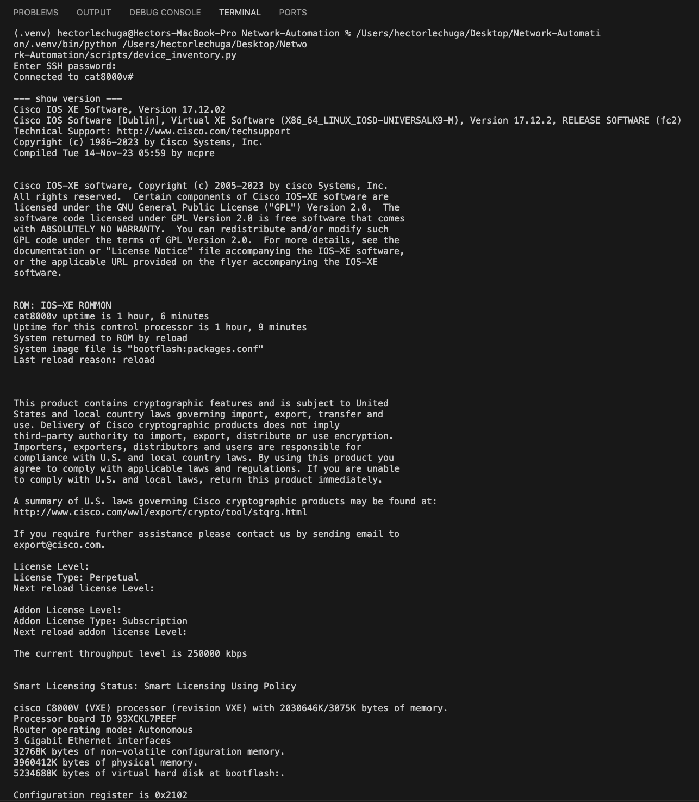
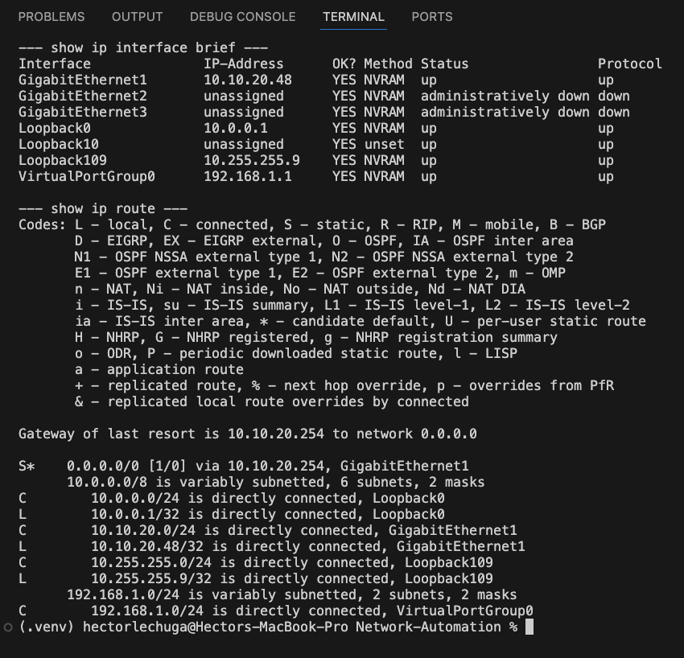
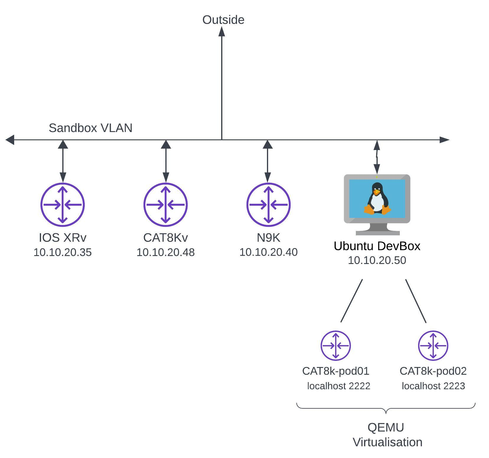

# Phase 1: Automated Device Inventory 

## Objective 

Automate the collection of Cisco network device information using Python and Netmiko module, elminiating the need to manually connect to devices and execute commands one by one.

## Lab Enviroment 

- **Platform:** Cisco Devnet Sandbox
- **Device:** Cisco Catalyst 8000v
- **Operating System:** Cisco IOS XE 17.12.02
- **Tools:** VS Code, Python, and Netmiko
- **Connection Protocol:** SSH

## Script

The Python script utilizes Netmiko's `ConnectHandler` to establish an SSH connection to the Cisco router.

SSH passwords are retrieved from an envirnment variable using Python's `os` module, avoiding hardcoded credentials.

Once connected, the script uses a `for` loop and Netmiko's `send_command()` method to execute the following commands:

|Command | Purpose |
|--------|---------|
|`show verison` | Retrieve device software and hardware info |
|`show ip interface brief` | Display interface IP addresses and status |
|`show ip route` | Retrieve IPv4 routing table |

A `try/except` block handles connection and command execution errors. 

## Testing and Results

### Network Topology

## Summary

Successfully automated SSH connectivity and retrieved network device information using Python and Netmiko, establishing a solid foundation for future network automation tasks.