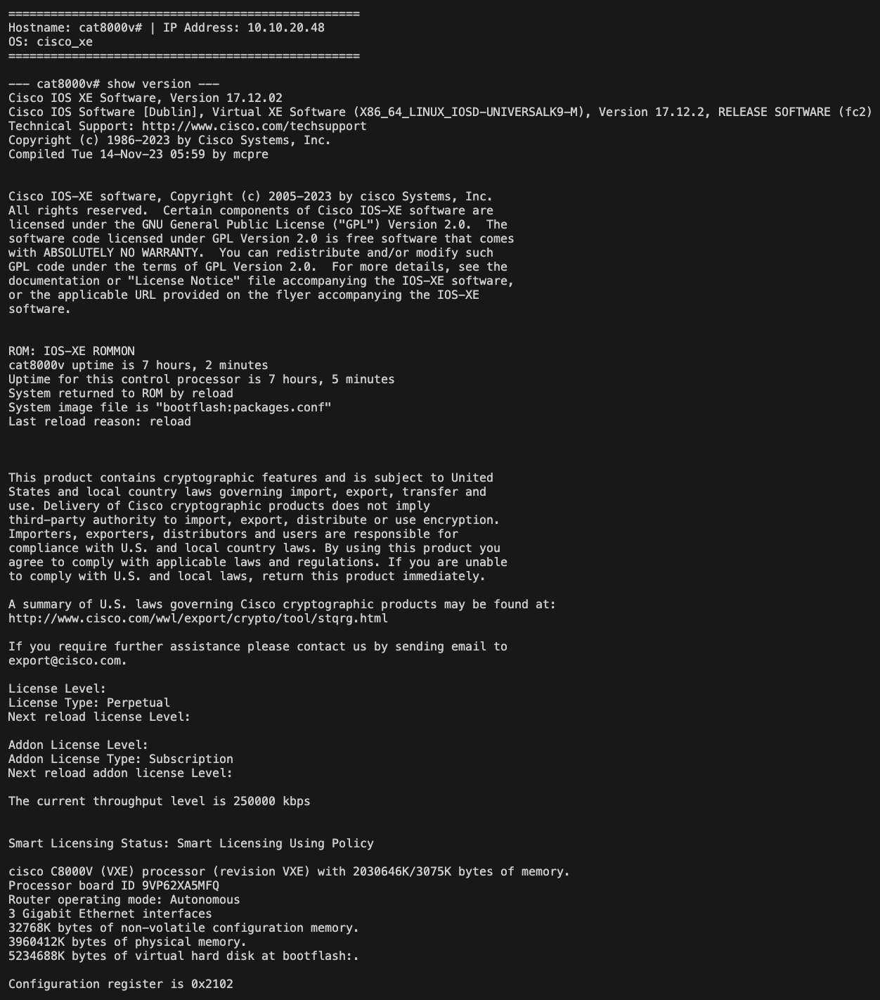
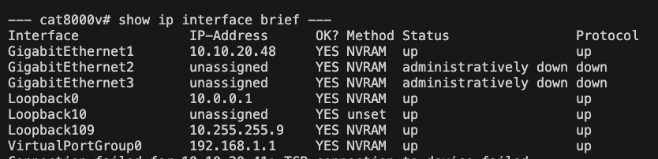
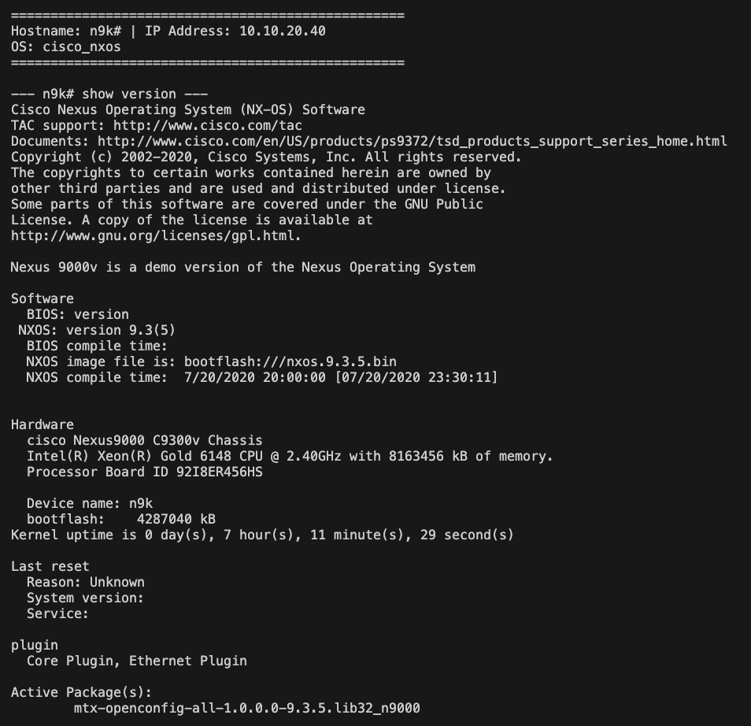
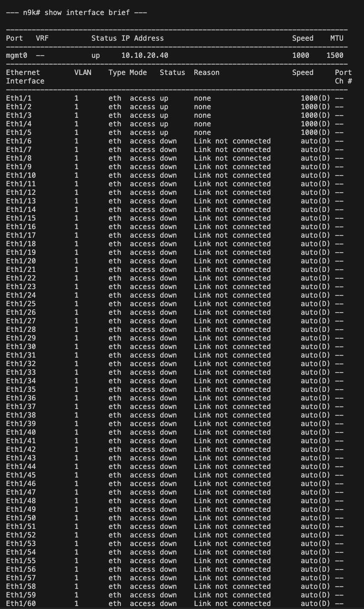
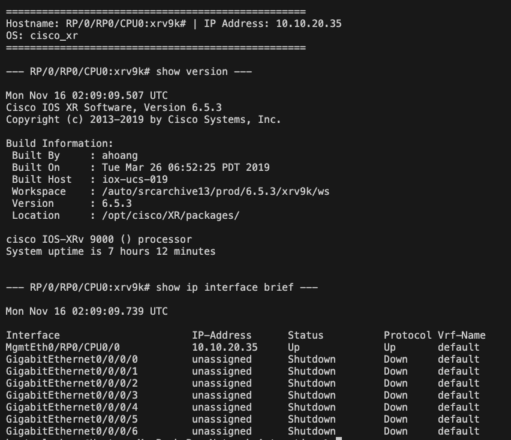
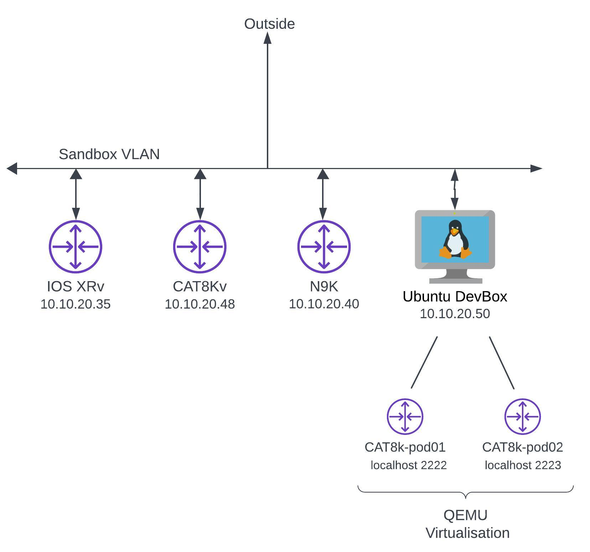

# Phase 2: Multi-Device Network Automation 

## Objective 

Expand on the Phase 1 device inventory script to connect to multiple Cisco network devices running different operating systems. Automated the collection of software versions and IP interface info using Python and the Netmiko module

## Lab Enviroment 

- **Platform:** Cisco Devnet Sandbox
- **Connection Protocol:** SSH over VPN
- **Devices:** 
    - Cisco Catalyst 8000v (`10.10.20.48`)
    - Nexus 9000k (`10.10.20.40`)
    - IOS XRv 9k (`10.10.20.35`)

## Script

I used a list of dictionaries to store device connection information and establishes SSH connections to each device using Netmiko. A command dictionary is used to execute OS specific CLI commands to retrieve software versions and IP interface information. The outputs are organized by hostname, IP address, and operating system for easier readability. Additionally, the script includes error handling to ensure that connection failures do not interrupt the script on the remaining devices. 

## Testing and Validation

Successfully connected to all three Cisco devices and retrieved their software versions and interface information.

### Cisco Catalyst 8000v — IOS XE

**Software Version**

**Interface Information**

### Cisco Nexus 9000v — NX-OS

**Software Version**

**Interface Information**

### Cisco IOS XRv 9000 — IOS XR

**Software Version and Interface Information**

### Connection Error Handling

Tested the script using an unreachable IP address (`10.10.20.41`). The script reported the connection failure without producing an unhandled Python exception.

### Network Topology

## Summary

Successfully developed a multi device network automation script supporting Cisco IOS XE, NX-OS, and IOS XR.

Demostrated automated network information collection across multiple Cisco OS using Python, CLI commands, and connection error handling.